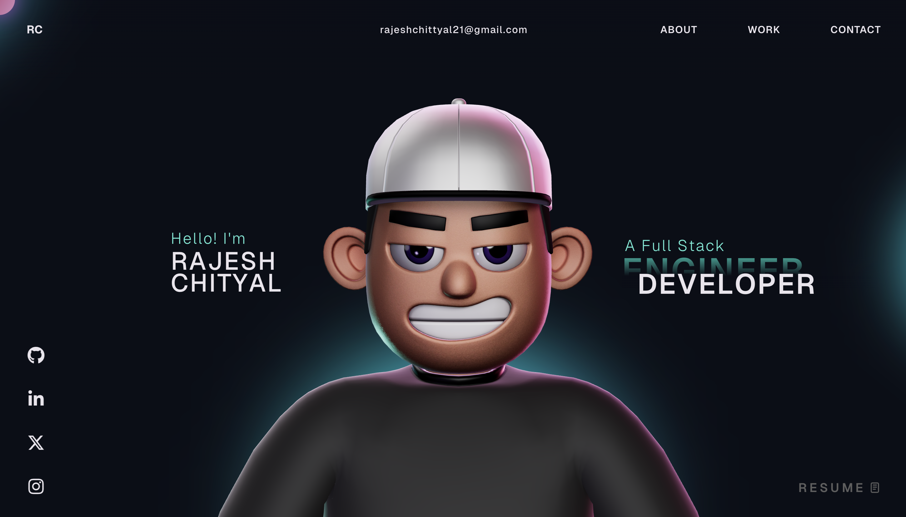

<h1 align="center">🌐 Yug Jain — 3D Interactive Portfolio</h1>
<p align="center">
  An immersive personal portfolio built with real-time 3D graphics, physics, and timeline-driven animations.
</p>
<p align="center">
  
  
  
  
  
</p>
<p align="center">
  
</p>

## 📌 Overview
A personal portfolio website that goes beyond a static page — featuring real-time 3D scenes, physics-based interactions, and smooth scroll-driven animations. Built with the React Three Fiber ecosystem, it renders interactive WebGL graphics directly in the browser while staying performant across devices.

## ✨ Highlights
- 🎨 Real-time 3D rendering with Three.js via React Three Fiber
- ⚛️ Physics simulation using Rapier (`@react-three/rapier`) for interactive elements
- 🎬 Timeline & scroll animations powered by GSAP for fluid section transitions
- ✨ Post-processing effects for polished, cinematic visuals
- 📱 Responsive across desktop and mobile
- 📈 Analytics integrated with Vercel Analytics

## 🛠 Tech Stack

| Category | Technology |
|----------|------------|
| Framework | React + TypeScript |
| 3D Engine | Three.js, React Three Fiber (`@react-three/fiber`) |
| 3D Helpers | Drei (`@react-three/drei`), postprocessing |
| Physics | Rapier (`@react-three/rapier`, `@react-three/cannon`) |
| Animation | GSAP + `@gsap/react` |
| Build Tool | Vite |
| Deployment | Vercel |

## 🚀 Getting Started

```bash
# Clone the repository
git clone https://github.com/yugj-arch/Yug-Portfolio.git
cd Yug-Portfolio

# Install dependencies
npm install

# Start the development server
npm run dev
```

*Note: This project uses GSAP Club plugins (replaced with trial versions in this open-source build). Trial plugins cannot be hosted — for full plugin access see the GSAP installation docs.*

```bash
# Build for production
npm run build

# Preview the build
npm run preview
```

## 📄 License
Released under the MIT License.

<p align="center">Designed &amp; built by <a href="https://github.com/yugj-arch">Yug Jain</a></p>
